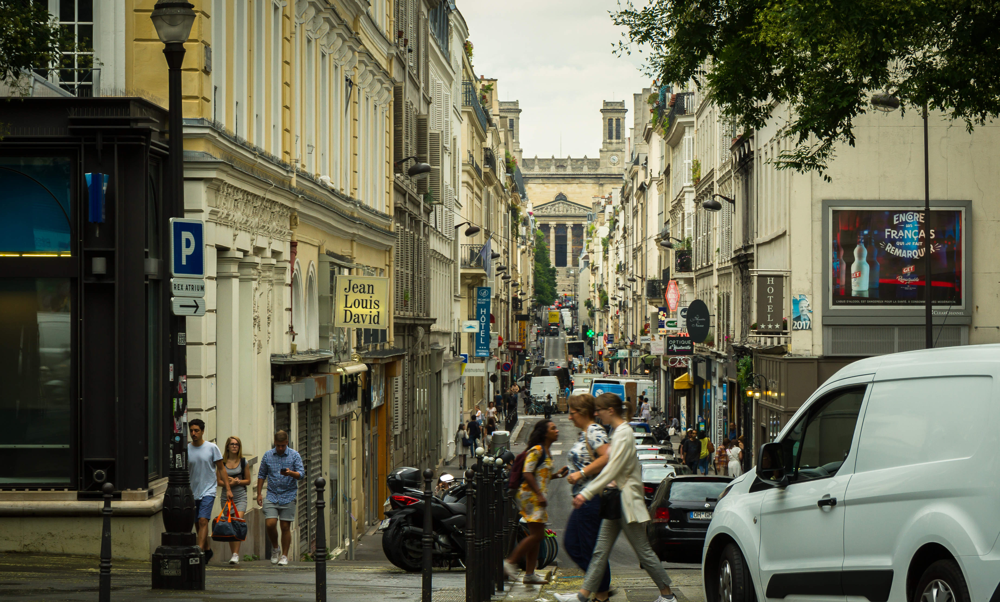
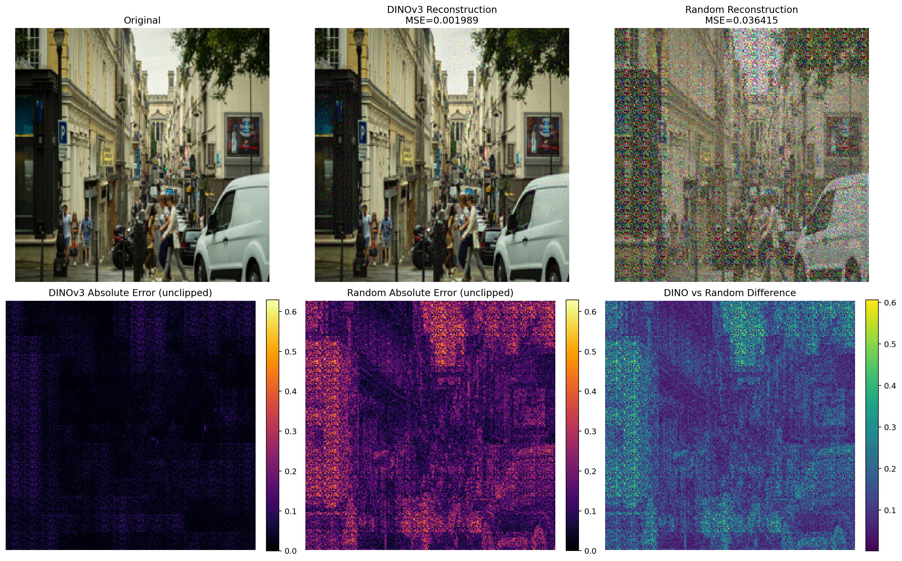
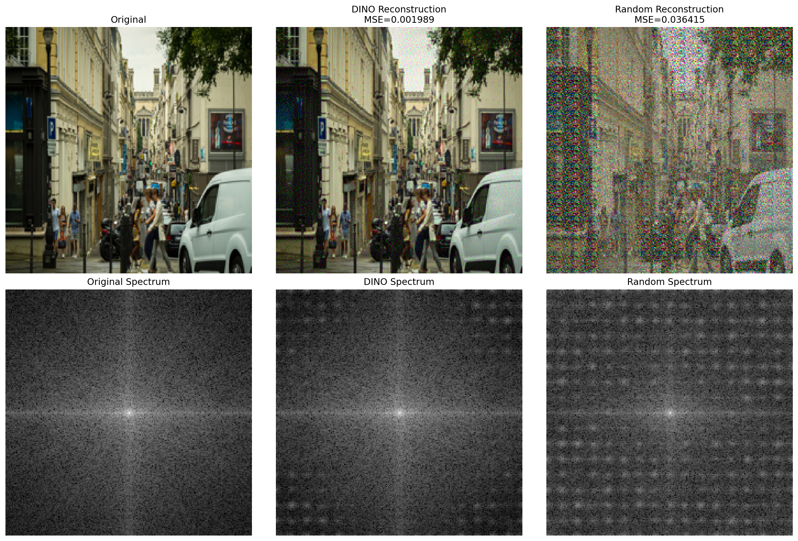
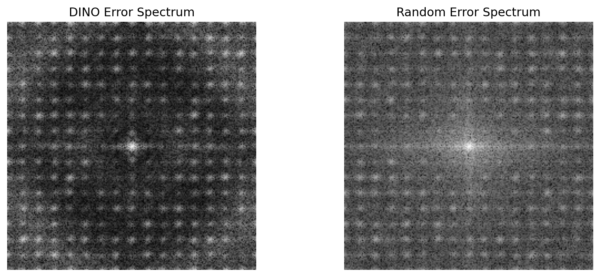
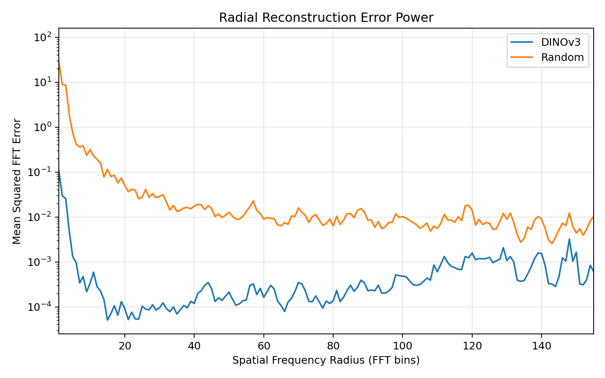

# Inside DINOv3: Understanding ViT Patch Embeddings

**English** | [繁體中文](README.zh-TW.md)

A small, reproducible study of what a pretrained ViT patch projection retains and discards. A pretrained ViT patch projection can discard measurable pixel information while producing unchanged patch embeddings in exact arithmetic. Frequency-domain analysis characterizes the discarded reconstruction residual, connecting linear algebra, image reconstruction, and patch embedding behavior.

The numerical results below show approximate embedding invariance at float32 precision. These experiments do **not** establish that DINOv3 learns safety-relevant features.

## Methodology

Model: `facebook/dinov3-vits16-pretrain-lvd1689m`, pinned to revision `114c1379950215c8b35dfcd4e90a5c251dde0d32` in [config.json](config.json).

| Experiment | Procedure |
| --- | --- |
| 01 | Inspect architecture, projection dimensions, rank, and output shape. |
| 02 | Reconstruct normalized patches using the pretrained projection's pseudoinverse; compare with a Gaussian random projection of identical dimensions. |
| 03 | Analyze RGB errors, grayscale spectra, radial profiles, and frequency-band residual energy. |
| 04 | Compare original and reconstructed patch embeddings and final encoder patch tokens, without clipping model inputs. |

Preprocessing preserves the original implementation: PIL RGB conversion, direct bicubic resize to **224 × 224** without cropping, division by 255, ImageNet mean `[0.485, 0.456, 0.406]` and standard deviation `[0.229, 0.224, 0.225]`, and non-overlapping **16 × 16** patches. The random baseline uses `torch.manual_seed(42)` and `randn_like(W) / sqrt(768)` with zero bias. The same seeded matrix is reused for every image; CPU is the reference device.

All MSE, error maps, reconstruction differences, FFTs, and token comparisons use **unclipped** values. Only RGB image displays are clipped to `[0, 1]`.

## Mathematics

A normalized RGB patch is a vector $`x\in\mathbb{R}^{768}`$. Its embedding is $`z=Wx+b`$, with $`W\in\mathbb{R}^{384\times768}`$. Pseudoinverse reconstruction gives

```math
\hat{x}=W^{+}(z-b)=W^{+}Wx,\qquad r=x-\hat{x}=(I-W^{+}W)x.
```

$`W^{+}W`$ is the orthogonal projector onto the row space of $`W`$. Therefore $`Wr=0`$ and $`W\hat{x}+b=Wx+b`$ in exact arithmetic, even when $`r\ne0`$. This is the minimum-norm reconstruction in **normalized patch coordinates**, not an optimal natural-image reconstruction. The measured rank is 384, leaving a 384-dimensional nullspace per patch. Downstream deterministic encoder outputs are also unchanged when their input embeddings are identical; float32 computation introduces small differences.

For frequency analysis, convert the original and raw reconstructed RGB arrays to grayscale using $`g=0.2989R+0.5870G+0.1140B`$, and let $`e=g-\hat{g}`$. With the orthonormal FFT $`E=\operatorname{fftshift}(\operatorname{fft2}(e,\mathrm{norm}=\text{ortho}))`$,

```math
\mathrm{MSE}_{g}=\frac{1}{HW}\sum_{u,v}|E_{u,v}|^2
=\sum_{B\in\{\mathrm{low,mid,high}\}}\frac{1}{HW}\sum_{(u,v)\in B}|E_{u,v}|^2.
```

Bands use Euclidean radius from the shifted FFT center, normalized by the maximum **corner** radius: low $`\rho\le0.15`$, mid $`0.15\lt\rho\le0.45`$, high $`\rho\gt0.45`$. Relative band error is residual energy divided by original grayscale energy in that band, with `1e-12` added to the denominator; it can exceed 1. These grayscale contributions sum to grayscale MSE, **not RGB MSE**. Magnitude plots use the original unnormalized FFT and `log1p(abs(FFT))`; radial curves average values in integer-floor radius bins. No windowing or mean subtraction is introduced; band energies include DC, while radial plots hide it.

## Verified results

Recomputed on the three committed images with the pinned checkpoint, Python 3.10.20, float32, and CPU. Exact package versions and input hashes are recorded in `results/reproduced/manifest_*.json`.

| Image | DINO RGB MSE | Random RGB MSE | Patch relative L2 | Encoder patch-token relative L2 |
| --- | ---: | ---: | ---: | ---: |
| sample | 0.00234239 | 0.05081408 | 2.88e-06 | 2.91e-06 |
| coffee | 0.00174924 | 0.03937276 | 3.05e-06 | 3.27e-06 |
| street | 0.00198920 | 0.03641510 | 2.65e-06 | 2.79e-06 |

The pretrained projection has lower reconstruction MSE than this seeded random baseline on these inputs. Patch and encoder patch-token cosine similarities round to 1.0; this does not imply bitwise equality. Maximum absolute projection differences are approximately `1.62e-5`–`2.86e-5`. The high band contributes the largest share of DINO's grayscale residual MSE on each input; this describes the residual rather than demonstrating that entire frequency bands are absent from embeddings.

Full precision tables: [reconstruction](results/reproduced/02_reconstruction.csv), [frequency summary](results/reproduced/03_frequency_summary.csv), [frequency bands](results/reproduced/03_frequency_bands.csv), [radial profiles](results/reproduced/03_radial_profiles.csv), and [nullspace verification](results/reproduced/04_nullspace.csv). RGB MSE in 02/03 uses NumPy and in 04 uses PyTorch; reductions can differ in the last digits.

### Key figures

Street-scene input (original aspect ratio; experiments resize it to 224 × 224):



Photo: Ali Sabbagh, CC0 1.0; [source and attribution](data/README.md).

Street reconstruction comparison and unclipped reconstruction error maps:



Grayscale image spectra and residual spectra:




Radial residual power:



Also available: [pixel error maps](results/reproduced/figures/street/pixel_error_maps.png), [radial magnitude](results/reproduced/figures/street/radial_frequency_profile_log.png), and [nullspace comparison](results/reproduced/figures/street/nullspace.png). The [sample comparison](results/reproduced/figures/sample/reconstruction.png) and [coffee comparison](results/reproduced/figures/coffee/reconstruction.png) are also available. Each input has its own [figure directory](results/reproduced/figures). The [historical archive note](results/legacy/README.md) explains why original figures are preserved locally and excluded from this public repository.

## Reproduction and changing images

Use Python 3.10 (reference: 3.10.20). From the repository root:

```bash
git clone https://github.com/PYBEARC/inside-dinov3-patch-embeddings.git
cd inside-dinov3-patch-embeddings
python -m venv .venv
source .venv/bin/activate
python -m pip install -r requirements.txt
# If this gated checkpoint is not already cached, obtain access on Hugging Face:
hf auth login
OMP_NUM_THREADS=2 MKL_NUM_THREADS=2 python scripts/run_all.py
```

The access token stays in your Hugging Face credential store; do not commit it. CPU was tested using `torch==2.6.0+cu118`; `requirements.txt` pins the base torch release to allow platform-specific wheels. GPU use (`--device cuda`) and other builds may change floating-point rounding. Manifests record the installed build. Once cached, use `--local-files-only` for an offline run.

**Change images in one place:** edit the `images` list in [config.json](config.json). Paths there are relative to the configuration file. All four experiments use that list automatically. Alternatively, override it without editing any code:

```bash
python scripts/run_all.py --images data/coffee.jpg data/street.jpg --out results/my_run
python scripts/03_frequency_analysis.py --image /path/to/new_image.jpg --out results/new_image
python -m unittest discover -s tests -v
```

`--images`/`--image` paths are relative to the working directory. Each input must have a unique filename stem to prevent figure collisions. Each numbered script accepts the same options: `--config`, `--images` (alias `--image`), `--out`, `--device`, and `--local-files-only`. Numbered scripts can run independently. Default output is `results/reproduced`; rerunning the same output path replaces its tables and corresponding figures. Use a new `--out` directory for each distinct run, since files from earlier image selections may otherwise remain.

Outputs include six CSVs (model dimensions, reconstruction, frequency summary, band energies, radial profiles, and token verification), per-image figures, and four JSON manifests containing checkpoint revision, seed, preprocessing, package versions, input hashes, and script hashes. CSVs contain all selected images, so comparisons no longer require reading values from plots. Tests check preprocessing parity, the affine nullspace identity, frequency-band boundaries, and Parseval energy accounting with out-of-range reconstruction values. The refactored reconstruction and frequency calculations were also compared against the original 02/03 implementations and matched exactly in the reference environment; the image change does not alter those calculations.

## Layout and limitations

```text
README.md                    # English documentation
README.zh-TW.md              # Traditional Chinese documentation
config.json                  # one image list, checkpoint revision, seed
scripts/01_...04_*.py         # the four existing experiments
scripts/common.py            # preprocessing, reconstruction, CLI, CSV, manifests
scripts/frequency.py          # original frequency definitions
scripts/run_all.py            # batch entry point
scripts/download_sample_images.py  # optional; requires scikit-image
requirements.txt             # tested direct dependencies
data/                       # reference images and provenance notes
results/reproduced/          # verified tables, manifests, per-image figures
results/legacy/              # note about locally preserved historical figures
tests/                      # numerical methodology checks
```

This is a three-image, one-checkpoint, one-random-seed study, with no population-level statistics. A random projection is a dimensionality baseline, not a trained competing encoder. Residual spectra depend on grayscale mixing, image content, resizing, patch boundaries, and the chosen bands. Exact nullspace invariance applies to raw normalized reconstruction values, which can fall outside the valid RGB range; clipping or saving and reloading them can destroy it. The pseudoinverse does not recover the original image uniquely, and reconstruction quality does not measure semantic quality or downstream safety. No new experiments or safety claims are added.

Image attribution and licenses are recorded in [data/README.md](data/README.md) and [data/sources.json](data/sources.json). The public road-scene input is Ali Sabbagh's CC0 Paris street photograph, not a driving benchmark. It replaces the former NVIDIA-sourced image; all street results were recomputed with the same methodology. The former image, original figures, and previous verified results remain in the ignored local `.local-archive/` directory. Historical `part_b` figures are also archived locally, outside the scope of 01–04; their generating script was absent. Model weights are obtained separately under their upstream terms.
