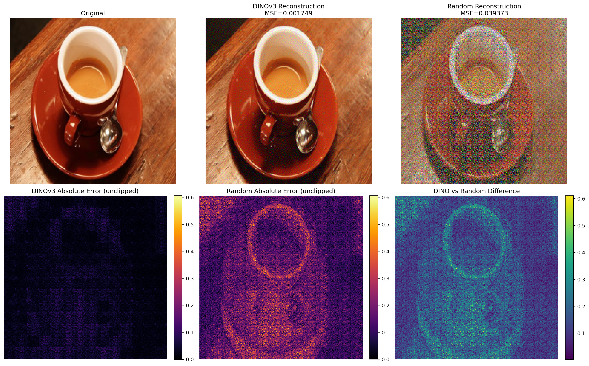
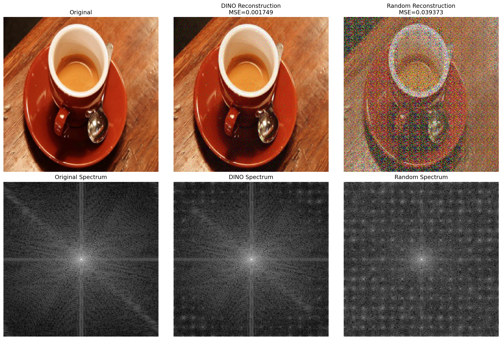
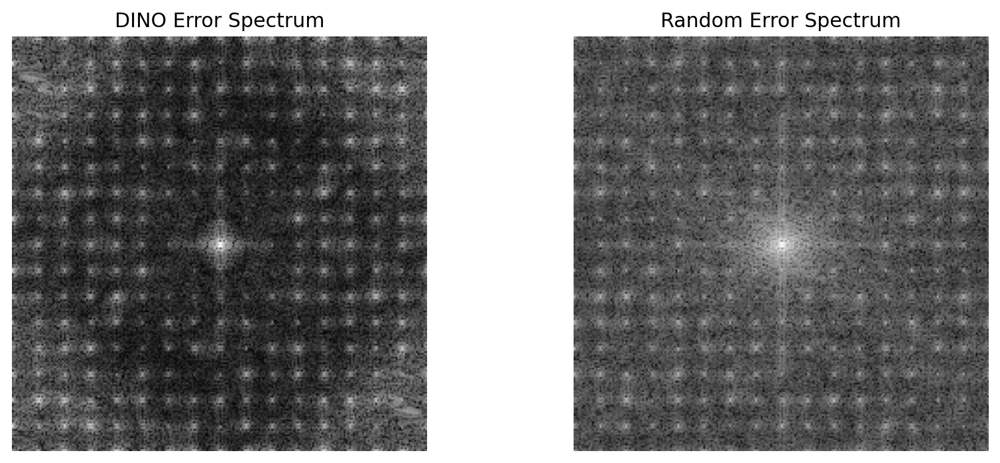
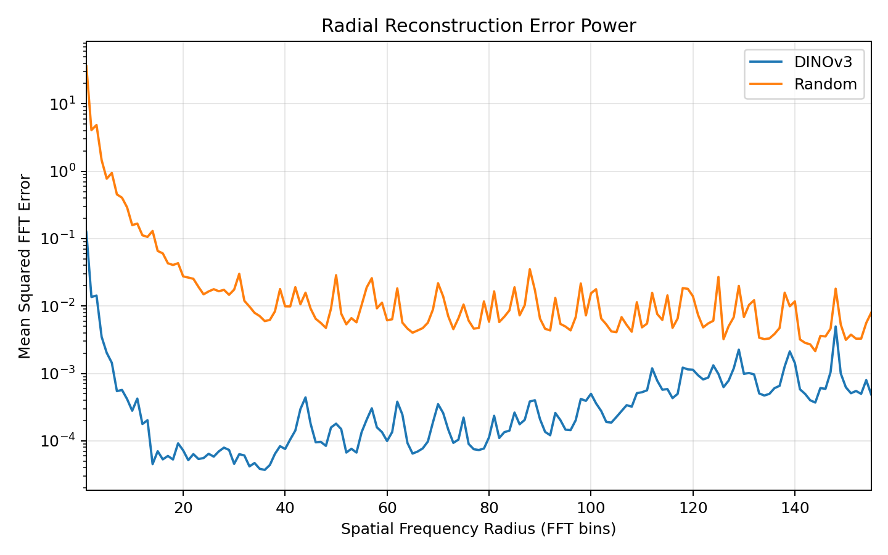

# Inside DINOv3：理解 ViT 的 Patch Embedding

[English](README.md) | **繁體中文**

這個小型實驗研究預訓練 ViT 的 patch projection 保留與捨棄了哪些像素資訊。主要結論是：**預訓練的線性 patch projection 可以捨棄可量測的像素資訊，同時在精確算術下產生完全相同的 patch embedding。** 分析重建殘差的頻譜，可以將線性代數、影像重建與 patch embedding 的行為連結起來。

以下實測結果顯示 float32 精度下的近似不變性。這些實驗**不能證明 DINOv3 學到了與安全相關的特徵**。

## 實驗方法

模型為 `facebook/dinov3-vits16-pretrain-lvd1689m`，版本固定為 `114c1379950215c8b35dfcd4e90a5c251dde0d32`，設定見 [config.json](config.json)。

| 實驗 | 內容 |
| --- | --- |
| 01 | 檢查模型架構、投影矩陣維度、秩與輸出形狀。 |
| 02 | 使用預訓練投影矩陣的偽逆重建正規化 patch，並與相同維度的高斯隨機投影比較。 |
| 03 | 分析 RGB 誤差、灰階頻譜、徑向頻率曲線與各頻帶的殘差能量。 |
| 04 | 比較原圖與重建圖的 patch embedding 及最後一層 encoder patch token；模型輸入不做數值裁切。 |

保留原始前處理：以 PIL 轉為 RGB，直接用 bicubic 縮放至 **224 × 224**，不做影像裁切；除以 255 後，使用 ImageNet 平均值 `[0.485, 0.456, 0.406]` 與標準差 `[0.229, 0.224, 0.225]` 正規化，再切成不重疊的 **16 × 16** patch。

隨機基準使用 `torch.manual_seed(42)`，矩陣為 `randn_like(W) / sqrt(768)`，偏置為零。同一個隨機矩陣用於所有圖片，參考執行裝置為 CPU。

**MSE、誤差圖、重建差異、FFT 與 token 比較一律使用未裁切的重建值。只有顯示 RGB 圖片時才將數值裁切至 `[0, 1]`。**

## 數學說明

一個正規化 RGB patch 可表示為 $x\in\mathbb{R}^{768}$，其 embedding 為 $z=Wx+b$，其中 $W\in\mathbb{R}^{384\times768}$。以偽逆重建：

$$
\hat{x}=W^+(z-b)=W^+Wx,\qquad r=x-\hat{x}=(I-W^+W)x.
$$

$W^+W$ 是投影到 $W$ 列空間（row space）的正交投影矩陣，因此 $Wr=0$。即使 $r\ne0$，在精確算術下仍有 $W\hat{x}+b=Wx+b$。此重建是在**正規化 patch 座標**下的最小範數解，並非最佳自然影像重建。

實測矩陣的秩為 384，因此每個 patch 的零空間（nullspace）維度為 384。若輸入 embedding 完全一致，後續確定性的 encoder 輸出也會一致；float32 計算則會產生微小差異。

頻域分析先將原圖與未裁切重建圖轉為灰階：$g=0.2989R+0.5870G+0.1140B$，並令 $e=g-\hat{g}$。使用正交歸一化 FFT：$E=\operatorname{fftshift}(\operatorname{fft2}(e,\mathrm{norm}=\text{ortho}))$，則有

$$
\mathrm{MSE}_{g}=\frac{1}{HW}\sum_{u,v}|E_{u,v}|^2
=\sum_{B\in\{\mathrm{low,mid,high}\}}\frac{1}{HW}\sum_{(u,v)\in B}|E_{u,v}|^2.
$$

頻帶沿用原始定義：以平移後 FFT 中心為原點，計算歐氏半徑，再除以最大**角落**半徑。低頻為 $\rho\le0.15$，中頻為 $0.15<\rho\le0.45$，高頻為 $\rho>0.45$。

相對頻帶誤差為該頻帶的殘差能量除以原圖灰階能量，分母加上 `1e-12`，所以可能大於 1。三個頻帶的 MSE 貢獻加總等於**灰階 MSE，而非 RGB MSE**。頻譜顯示使用未歸一化 FFT 的 `log1p(abs(FFT))`；徑向曲線依半徑向下取整後分組平均。不額外加窗或扣除平均值；頻帶能量包含 DC，徑向圖則不顯示 DC。

## 已驗證結果

使用固定版本模型，在三張既有圖片上以 Python 3.10.20、float32 與 CPU 重跑。套件版本及輸入圖片雜湊記錄於 `results/reproduced/manifest_*.json`。

| 圖片 | DINO RGB MSE | 隨機投影 RGB MSE | Patch 相對 L2 | Encoder patch token 相對 L2 |
| --- | ---: | ---: | ---: | ---: |
| sample | 0.00234239 | 0.05081408 | 2.88e-06 | 2.91e-06 |
| coffee | 0.00174924 | 0.03937276 | 3.05e-06 | 3.27e-06 |
| street | 0.00198920 | 0.03641510 | 2.65e-06 | 2.79e-06 |

在這三張圖片上，預訓練投影的重建 MSE 低於此固定種子的隨機基準。Patch 與 encoder patch token 的餘弦相似度四捨五入後為 1.0，但不代表逐位元相等；投影輸出的最大絕對差異約為 `1.62e-5` 至 `2.86e-5`。

每張圖片的 DINO 灰階殘差 MSE 都以高頻帶的貢獻最大。這描述的是重建殘差，不能據此推論 embedding 完全捨棄了某個頻帶。

完整精度表格：[重建結果](results/reproduced/02_reconstruction.csv)、[頻域摘要](results/reproduced/03_frequency_summary.csv)、[頻帶能量](results/reproduced/03_frequency_bands.csv)、[徑向曲線](results/reproduced/03_radial_profiles.csv)、[零空間驗證](results/reproduced/04_nullspace.csv)。02／03 的 RGB MSE 以 NumPy 計算，04 使用 PyTorch，加總順序可能造成末位數字不同。

### 關鍵圖表

Coffee 圖片的重建比較與未裁切誤差圖：



灰階影像頻譜與重建殘差頻譜：




徑向殘差功率：



另有[像素誤差圖](results/reproduced/figures/coffee/pixel_error_maps.png)、[徑向頻譜幅值](results/reproduced/figures/coffee/radial_frequency_profile_log.png)與[零空間重建比較](results/reproduced/figures/street/nullspace.png)。各圖片的輸出分別放在[圖表目錄](results/reproduced/figures)。原始圖表保存在本機，公開版的排除原因見[歷史封存說明](results/legacy/README.md)；不臆造缺失的歷史數值紀錄。

## 重現與更換圖片

使用 Python 3.10，參考版本為 3.10.20。在專案根目錄執行：

```bash
git clone https://github.com/PYBEARC/inside-dinov3-patch-embeddings.git
cd inside-dinov3-patch-embeddings
python -m venv .venv
source .venv/bin/activate
python -m pip install -r requirements.txt
# 若尚未快取模型，請先取得 Hugging Face 上該模型的存取權限：
hf auth login
OMP_NUM_THREADS=2 MKL_NUM_THREADS=2 python scripts/run_all.py
```

存取 token 保留在 Hugging Face 憑證儲存區，不加入 Git。參考執行使用 `torch==2.6.0+cu118` 的 CPU 運算；`requirements.txt` 固定基本版本，允許不同平台安裝對應的 wheel。使用 `--device cuda` 或其他套件建置版本可能改變浮點捨入結果，實際版本會寫入執行紀錄。模型已快取時，可加上 `--local-files-only` 離線執行。

**換圖只需改一處：** 修改 [config.json](config.json) 的 `images` 清單，01–04 就會自動共用。設定檔內的圖片路徑以設定檔所在目錄為基準，也可以用參數直接覆寫：

```bash
# 一次處理多張圖片
python scripts/run_all.py --images data/coffee.jpg data/street.jpg --out results/my_run

# 單獨執行頻域分析
python scripts/03_frequency_analysis.py --image /path/to/new_image.jpg --out results/new_image

# 執行數值方法測試
python -m unittest discover -s tests -v
```

`--images`／`--image` 的路徑以目前工作目錄為基準。圖片的檔名主體必須互不相同，避免輸出互相覆蓋。每個編號腳本都接受 `--config`、`--images`（別名 `--image`）、`--out`、`--device` 與 `--local-files-only`，可獨立執行。

預設輸出為 `results/reproduced`。重跑同一目錄會覆寫對應表格與圖表，但先前其他圖片的檔案可能仍保留，建議每組執行使用新的 `--out` 目錄。

輸出包含六份 CSV（模型資訊、重建結果、頻域摘要、頻帶能量、徑向曲線、token 驗證）、逐圖圖表及四份 JSON 執行紀錄。紀錄包含模型版本、seed、前處理、套件版本、圖片與腳本雜湊。CSV 彙整所有指定圖片，不必再從圖上手動讀取數值。

測試涵蓋前處理一致性、仿射投影的零空間性質、頻帶邊界，以及包含超出 `[0, 1]` 重建值的 Parseval 能量驗證。重構後的重建與頻域計算也曾對照原始 02／03 程式，在參考環境完全一致；更換輸入圖片不改變這些計算方法。

## 目錄結構與限制

```text
README.md                    # 英文說明
README.zh-TW.md              # 繁體中文說明
config.json                  # 統一圖片清單、模型版本與 seed
scripts/01_...04_*.py         # 四個既有實驗
scripts/common.py            # 前處理、重建、CLI、CSV 與執行紀錄
scripts/frequency.py         # 原始頻域定義
scripts/run_all.py           # 批次執行入口
scripts/download_sample_images.py  # 選用，需額外安裝 scikit-image
requirements.txt             # 已測試的直接相依套件
data/                       # 參考圖片與來源說明
results/reproduced/          # 已驗證表格、紀錄與逐圖圖表
results/legacy/              # 本機歷史圖表的封存說明
tests/                      # 數值方法測試
```

本研究僅涵蓋三張圖片、一個模型版本與一個隨機種子，沒有母體統計推論。隨機投影只是維度基準，不是另一個訓練過的 encoder。殘差頻譜受灰階轉換、影像內容、縮放、patch 邊界與頻帶定義影響。

精確的零空間不變性適用於未裁切的正規化重建值；轉回 RGB 後可能超出合法範圍，數值裁切或存檔再讀取可能破壞不變性。偽逆無法唯一還原原圖，重建品質也不等於語意品質或下游安全性。本專案不加入新實驗或安全性主張。

圖片來源與授權見 [data/README.md](data/README.md) 及 [data/sources.json](data/sources.json)。公開版的道路輸入是 Ali Sabbagh 以 CC0 提供的巴黎街景照片，並非行車基準資料集；更換原 NVIDIA 圖片後，已使用相同方法重算所有街景結果。原 NVIDIA 圖片、原圖表與先前已驗證的結果保存在本機 `.local-archive/`，不加入 Git。歷史 `part_b` 圖片也僅保留於本機，原始產生腳本不存在，不納入 01–04 的結論。模型權重需另外依上游條款取得。
